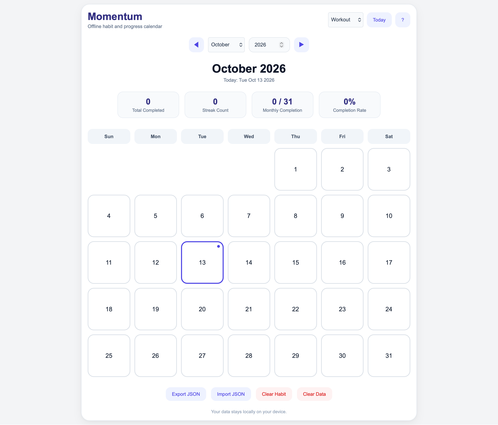
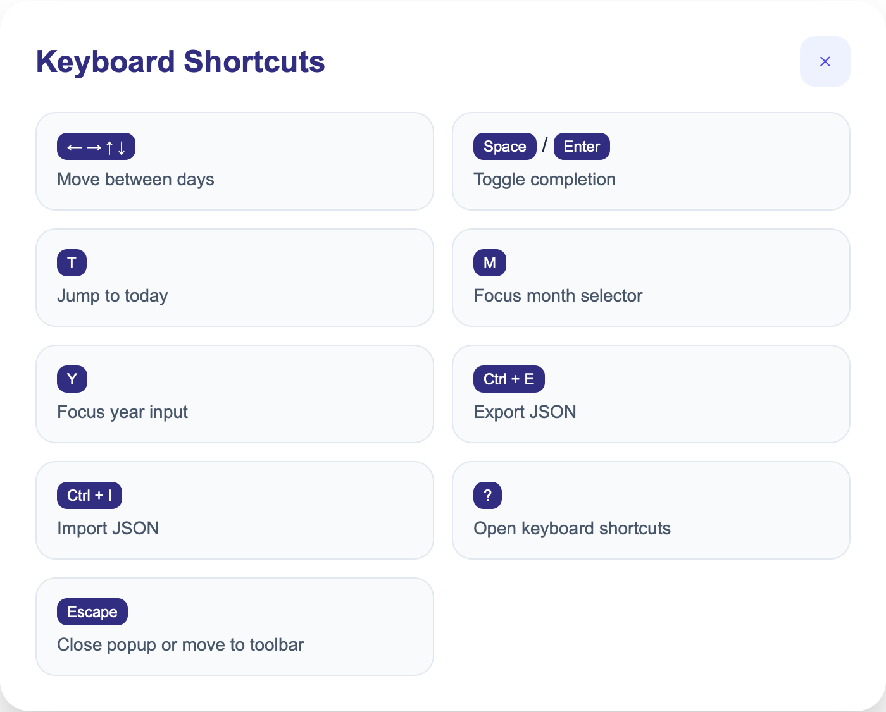

# Momentum
A browser-based habit tracker and progress calendar with stats and full keyboard support.

## Features

- Track a variety of your habits, each habit maintaining its own calendar wise progress and statistics.
- Simple design, with visual clarity and keyboard shortcut support, to allow you to focus on tracking and not tweaking.
- Easy keyboard toggles as under:

- Import and Export of json files
- Reset data of a singular habit
- Reset all data

- Fully browser based, data stays in your own browser. No telemetry, no data sharing. Full privacy.
- (**Caution:** _As data stays in your browser, be responsible for keeping backup of your data, in case browser crashes or an accidental clear browser data._)

## Future Goal

- Transform this into a web app.

## Roadmap
Add features for:
- Adding new habit through the screen
- Adding notes to individual days
- Configuration of reminders or set days on which habit gets triggered (instead of daily tracking).

# Notice

Created by: Meet Vekaria
(Attribution required if reusing to develop/build anything)
